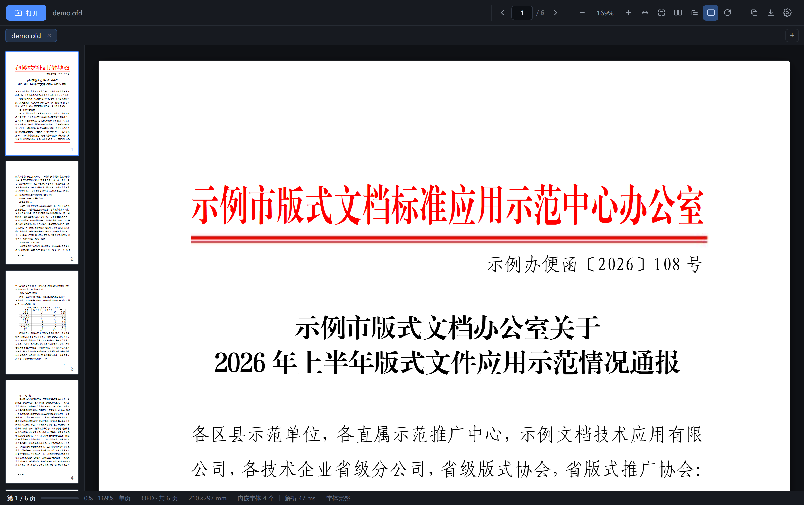

# OFDee

<p align="center">
  
</p>
<p align="center">
  <a href="https://github.com/gityongzhong/OFDee/releases">下载便携版</a>
</p>

打开、阅读 **OFD**（GB/T 33190-2016 版式文档，电子发票 / 电子公文 / 电子票据常用格式）与 **PDF** 的桌面软件。
免安装便携版：单文件 exe，双击即用，不写注册表，数据保存在程序目录。

## 功能

- 打开：按钮选择（原生文件对话框）、拖拽进窗口、命令行传参（`OFDee.exe 文件.ofd|文件.pdf`）
  - **单实例**：程序已在运行时再双击文件，不会多开一个窗口，而是在已有窗口里打开新标签
    （并自动取消最小化、把窗口提到前台）
- 类型识别按文件头判断（`%PDF` / `PK`），改了扩展名也能正常打开
- 渲染：
  - OFD：文本（含内嵌字体）、表格线/路径、图片、印章图像；版面按毫米精确还原，SVG 矢量输出
  - PDF：pdf.js（Apache-2.0）光栅渲染，内置 cmaps 与标准字体资源，中文 CID 字体可正常显示
- 阅读：连续滚动翻页、页码跳转、缩略图侧栏、**单页/双页对开切换**（记住模式）、缩放（10%~600%、适应宽度/整页、Ctrl+滚轮）
  - PDF 缩放后按新分辨率重绘（防抖合并），旧画布 CSS 拉伸过渡不闪白
  - **页面旋转**：当前页 / 全部页顺时针 90°，可复位；只改显示不改文件。
    PDF 文字层随旋转自动对齐（仍可划选复制），缩略图、双页对开、适应宽度全部跟随；
    导出 PNG / 全文 PDF 时按旋转后的方向落盘（PDF 有旋转时自动放弃原样转存改为重渲染）；
    旋转状态随标签保留，切换标签不丢
  - 适应宽度/整页按**所有页里的最大尺寸**适配（而非只看第一页），
    扫描件各页尺寸不一、或部分页旋转后也不会横向溢出
  - **缩略图侧栏默认展开**：打开文档即见；收起/展开的选择会被记住（无文档时自动不占位）；
    展开与收起时阅读区按当前模式重新适配宽度
  - 适应宽度在量取可用宽度前先锁定竖向滚动条占位，避免「滚动条出现前后」量出的宽度差一截，
    保证同一窗口里不同标签的适宽比例一致
- **目录侧栏**：PDF 解析书签树（命名目标/显式目标均支持），OFD 解析 `Bookmarks` 中文大纲；
  没有内置目录时自动降级为页面快速跳转网格；翻页时目录高亮自动跟随当前章节
- **多标签页**：同时打开多份文档（OFD/PDF 可混开），每个标签独立保留缩放、页码、滚动位置与渲染缓存，
  切换零等待；同一路径已打开则直接激活已有标签；加载失败自动回滚不产生空标签；
  **标签可拖拽排序**（指针拖动 + 中线落点判定 + 落位回弹动画，点关闭/拖窗口方向不误触）
- 键盘：←/→/PageUp/PageDown 翻页，+/- 缩放，Home/End 首末页，Ctrl+O 打开，
  Ctrl+W 关标签，Ctrl+Tab / Ctrl+Shift+Tab 切换标签，Ctrl+T 新标签（打开文件）
- 文字：**PDF 划选复制**（透明文字层覆盖，与画布逐字对齐）、Ctrl+C 复制选中、Ctrl+A 全选当前页、
  右键菜单（复制选中/复制整页文字/缩放）；OFD 当前页文字一键复制（扫描件无文字层会提示）
- 导出：当前页 PNG（OFD 2 倍 / PDF 144DPI）
- 全部页导出 PNG（zip 打包，OFD/PDF 均可）
- OFD 全文转 PDF（2 倍分辨率光栅化 + 自研最小 PDF 合成器，含 /ID 与随机文件 ID）；PDF 可原样转存
- 保存走原生「另存为」对话框（数据 base64 过 IPC）
- 状态栏双区：左侧实时区（页码、阅读进度条、百分比、缩放、单双页模式），右侧信息区（加载/错误/提示）
- 界面细节：
  - **浅灰主题**（CSS 变量全面主题化，见设置 → 外观）；页面纸张质感（多层投影 + 圆角），
    单页纵向间距 28px，双页对开横向 18px（跨页更整体）
  - 工具栏图标按钮悬停出即时中文气泡（含快捷键，0.6s 延时防扫过闪烁，贴边自动收，禁用态不弹）
  - 工具栏文档名/空白处与标签条空白处可拖动窗口；未打开文档时依赖文档的按钮整组置灰
  - **窗口位置与大小记忆**：含最大化状态；拖动/缩放时节流写盘，关闭时补记
    （存 `%APPDATA%\OFDee\window.json`，与文档状态分开存以免互相覆盖）；
    换了显示器或分辨率后若记录位置已在屏幕外，自动回退居中，不会跑到看不见的地方
- **设置面板**（工具栏齿轮）：
  - **外观三档**：跟随系统 / 深色 / 浅灰，`跟随系统` 实时响应 Windows 深浅色切换；
    选择持久化于状态文件（另有 localStorage 兜底与首屏防闪脚本，启动无闪白）
  - **文件关联**：一键开关「双击 .ofd 文件用 OFDee 打开」，写入 HKCU 级注册表
    （`Software\Classes\OFDee.Document` ProgID + `.ofd` OpenWithProgids），免管理员权限；
    关闭即完整清理注册表不留残留；状态持久化于 `%APPDATA%\OFDee\assoc.flag`
  - 关于区：版本号、程序目录、便携版说明
- 最近打开列表与单页/双页模式（保存在 `%APPDATA%\OFDee\ofd-reader-state.json`；旧版 exe 旁的状态文件会自动迁移，桌面不再出现数据文件）

### 命令行参数

- `OFDee.exe 文件.ofd|文件.pdf`：直接打开文档
- `OFDee.exe --assoc=on|off|status`：设置/查询 .ofd 文件关联（结果同时写 `%TEMP%\ofdee-assoc.out`，便于脚本调用）

## 特点

- **OFD 自研渲染内核**：不依赖任何第三方 OFD 库（调研过的 ofd.js 各版本要么闭源需授权码、要么 emscripten 产物残缺）
- **PDF 用 pdf.js**：唯一第三方渲染库，随 exe 内嵌（含 worker、cmaps、standard_fonts，共约 3.6MB 资源）
- 按需懒渲染：只渲染视口附近页面，长文档不吃内存；PDF 渲染限 2 页并发
- **OFD 内嵌字体修复**：国产 OFD 内嵌字体常见三类不合规（表目录乱序、`OS/2` 标签写成小写 `os/2`、
  cmap 末段哨兵字形越界），启动时自动重建 sfnt 并修补 cmap，让浏览器字体引擎接受，
  红头文件的黑体/小标宋/仿宋/楷体得以原样显示
- **DeltaX/DeltaY 压缩语法（`g n v`）**：按 GB/T 33190-2016 标准语义解析（`g n v` = 值 v 重复 n 次）。
  此前误把「重复次数」当间距值，WPS 生成的 OFD 约 71% 字符被挤到一起，视觉上像丢了字；
  已用真实红头文件全量 424 条 Delta 交叉比对修复（tools/delta_crosscheck.mjs）
- OFD 路径零第三方 JS 依赖：ZIP 解压用原生 `DecompressionStream`，XML 用原生 `DOMParser`

## 构建

```
cd src-tauri
cargo build --release        # 产物 target/release/ofd-viewer.exe（约 9 MB，含 PDF 支持）
```

前端无构建步骤：`ui/` 目录由 Tauri v2 在编译期整体嵌入 exe（frontendDist）。
pdf.js 相关资源在 `ui/vendor/`（Apache-2.0，见 `LICENSE-pdfjs.txt`）。
图标由 `make_icon.py` 生成（纯标准库，改图标后重跑一次）。
调试工具：`tools/cdp.mjs` 通过 CDP 驱动无头 Chrome 做真实渲染验证（Web Worker 与 `--virtual-time-budget` 不兼容）。

## 已知边界 / 下一步

- 不做编辑、批注、签章验签、OFD/PDF 生成
- 加密 OFD 未支持；加密 PDF 会明确提示需要密码（暂无输密码界面）
- 打印未实现；OFD 转 PDF 为图片型 PDF（文字不可选中）
- 大文件（>50MB 扫描件）经 IPC 传字节数组，速度待优化（可改 Tauri response 流）
- 文件关联目前仅 .ofd（.pdf 关联暂未开放，避免与其他 PDF 阅读器抢占默认打开方式）
- 样本覆盖：OFD 已在党政公文类真实样本验证，发票/票据/扫描件类待样本实测；
  PDF 在自造的中文文本样本验证过，扫描件/图片型 PDF 待实测
